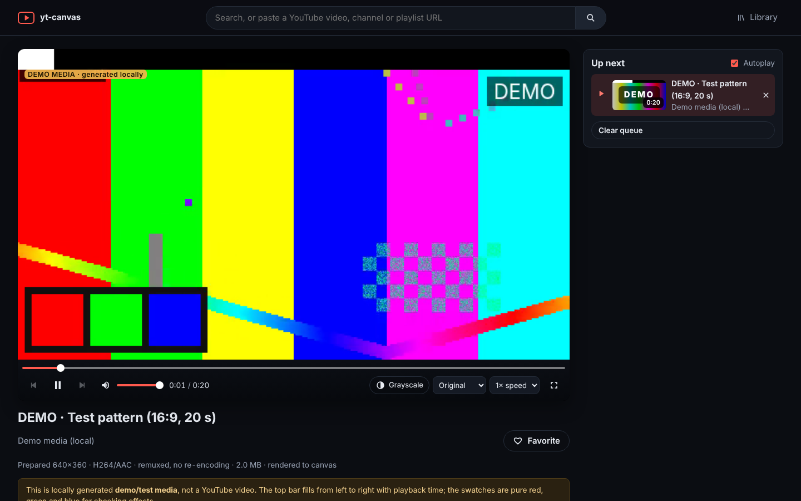

# yt-canvas

Browse YouTube (search, channels, playlists) and play videos whose **frames are decoded one by one and drawn into an HTML `<canvas>`**. There is no `<video>` element in the page:
- the compressed video is fetched in byte ranges;
- WebCodecs (`VideoDecoder`) turns each frame into an image, which Canvas 2D draws, with an optional visual effect (grayscale, sepia, invert, pixelate);
- the sound is decoded with `AudioDecoder` and played through Web Audio, whose clock keeps the picture in sync.

Browsers without WebCodecs fall back to a hidden `<video>` element as the decoder.

- **Backend:** Python + FastAPI, with `yt-dlp` for discovery and media acquisition and FFmpeg/ffprobe for merging and conversion.
- **Frontend:** React + TypeScript + Vite, in a YouTube-style layout built with Tailwind CSS v4 and shadcn/ui-style components (Radix primitives, lucide icons), with dark and light themes. Favorites and history live in `localStorage`.



> **Note:** Playback of extracted media happens outside YouTube's official embedded player. Any deployment must account for content rights and YouTube's Terms of Service.

## Quick start

Requirements (versions this was built and tested with):

| Tool | Required | Tested |
|---|---|---|
| Python | 3.11+ | 3.13.17 |
| Node.js / npm | 22.13+ (Vite 8, Vitest 5, jsdom 29) | 22.22.0 / 10.9.4 |
| FFmpeg + ffprobe | with `libx264` and `aac` | 6.1.1 (Ubuntu 24.04 build) |
| JavaScript runtime for yt-dlp | **Deno ≥ 2.3.0** (recommended, used automatically), or Node ≥ 22.0.0 via `YTC_YTDLP_JS_RUNTIMES=node` | Deno 2.9.8 |

macOS and Linux are supported. On Windows, use WSL2 (Ubuntu) and follow the Linux steps: the backend relies on POSIX process groups to stop yt-dlp and FFmpeg cleanly.

Install the tools:

- **macOS (Homebrew):** `brew install python@3.13 node ffmpeg deno`. The `python3` that ships with Apple's developer tools is too old, so pass the Homebrew one to setup: `make setup PYTHON=python3.13`.
- **Ubuntu / Debian / WSL2:**
  - `sudo apt install python3 python3-venv ffmpeg make`. Ubuntu 22.04's Python 3.10 is too old: install `python3.11` and `python3.11-venv` and run `make setup PYTHON=python3.11`.
  - Node 22.13+ from [nodejs.org](https://nodejs.org) or nvm, since distribution packages are usually older.
  - Deno: `curl -fsSL https://deno.land/install.sh | sh`.

Then:

```bash
git clone https://github.com/deviBuilds/yt-canvas && cd yt-canvas
make setup          # backend venv + pip install, frontend npm ci (checks Python/Node versions)
cp .env.example .env  # optional; every setting has a default
make check-deps     # shows yt-dlp / yt-dlp-ejs / JS runtime / FFmpeg status
make dev            # backend :8000 + Vite :5173 → open http://127.0.0.1:5173
make test           # backend + frontend unit tests
make setup-e2e      # once: download the Chromium build Playwright tests with
make e2e            # browser tests with the local demo media
make test-live      # real YouTube end to end (the sandbox's 403 came from its datacenter network)
```

Prepared videos go to your system temp directory by default. Set `YTC_DATA_DIR` in `.env` to keep them somewhere permanent.

Production-style, with a single origin serving the built UI, the API and the media:

```bash
make start          # builds frontend/dist, serves everything on http://127.0.0.1:8000
```

Without `make`:

```bash
python3 -m venv backend/.venv && backend/.venv/bin/pip install -r backend/requirements-dev.txt
(cd frontend && npm ci)
(cd backend && .venv/bin/python -m uvicorn app.main:app --port 8000) &
(cd frontend && npx vite)
```

Run a single backend process (no `--workers`), because jobs, leases and caches live in memory.

### yt-dlp's YouTube requirements (checked 2026-10-28)

yt-dlp 2026.10.26 must solve YouTube's JavaScript challenges with the **yt-dlp-ejs** scripts (0.8.0, installed by `yt-dlp[default]`), running on an **external JS runtime**. The [EJS wiki](https://github.com/yt-dlp/yt-dlp/wiki/EJS) lists the supported runtimes:

- **Deno** ≥ 2.3.0: recommended, and the only one enabled by default.
- **Node** ≥ 22.0.0: enable with `YTC_YTDLP_JS_RUNTIMES=node`.
- **QuickJS**: supported.
- **Bun** 1.2.11–1.3.14: supported but deprecated.

Without a runtime, formats go missing or extraction fails. `GET /api/health` and the UI banner say which runtime is in use, and the backend always passes `--ignore-config` so a user-level yt-dlp config can't change its behaviour.

## Using it

- **Search bar:** type keywords, or paste a video, playlist or channel URL. The forms below are accepted, anything else (including other hosts) is rejected:
  - videos: `youtube.com/watch?v=…`, `youtu.be/…`, `/shorts/…`, `/embed/…`, `/live/…`, the `m.`, `music.` and `youtube-nocookie.com` hosts; `t=` start times and `&list=` playlists are honoured
  - playlists: `/playlist?list=…`
  - channels: `/channel/UC…`, `/@handle`, `/c/…`, `/user/…`, or a bare `@handle`
  - search URLs: `/results?search_query=…`
- **Layout:** like YouTube's web app, matched to its measured sizes:
  - **Top bar:** a single-pill search box with a mic button for voice search (where the browser supports speech recognition), and an avatar menu with the Library pages and the device, dark or light theme.
  - **Sidebar:** Home, your Library (History, Favorites) and Explore (Music, News, Live, Gaming). It's full width from 1312 px, a 72 px icon rail from 792 px, and a drawer on phones and on the watch page.
- **Home** has a row of chips (feeds, recent searches and topic searches), then one continuous grid of videos, as on YouTube. **Continue watching** appears as a shelf after the first row. The grid mixes:
  - YouTube's **public Music, News, Live and Gaming pages** (see [Home feeds](#home-feeds-and-related-videos))
  - more videos from the channels you watch most and from your latest search, taken only from this browser's history.

  If you [sign in (opt-in)](#signing-in-opt-in), Home shows YouTube's own recommendations and your topic chips instead.
- **Search results** use YouTube's list layout; channels and playlists have their own headers with **Play all** (and **Shuffle** for playlists). Every card has a ⋮ menu: add to queue, save to Favorites, remove from history, open on YouTube.
- **Watch page:** the canvas player has:
  - play/pause, seek, volume/mute, previous/next and fullscreen, plus a settings gear with speed (0.25–2×) and the visual effect
  - an effect toggle (the ✦ button)
  - an "Up next" panel for the queue or playlist, with autoplay, above YouTube's related videos (or more from the channel when those aren't available). When the queue runs out, "next" and autoplay continue with the first related video.
  - keyboard shortcuts: Space/K, ←/→, J/L, ↑/↓, M, F, G, `<`/`>`, 0–9, Shift+N/P
- **Demo media** is hidden from the UI; open `/demo` to play the locally generated clips.
- **Load more** appears only when the provider actually reported another page.

## How it works

```
frontend/src/
  components/   cards, shelves, chips, app shell; ui/ holds the shadcn-style primitives
  feeds/        home feeds and related videos (API client, feed list)
  views/        Home, Feed, Search, Channel, Playlist, Watch, Library/History/Favorites, Demo
  theme/        device/dark/light theme (public/theme-init.js applies it before first paint)
  discovery/    API client + paged results hook (search, channel, playlist)
  preparation/  job API, polling hook, progress/errors panel
  player/       CanvasRenderer (frame loop), CanvasPlayer (component), controls, effects, sizing
  library/      favorites / history / recent searches (localStorage)
  queue/        playback queue (sessionStorage)
backend/app/
  discovery/    DiscoveryProvider interface, yt-dlp flat provider, normalization, TTL cache,
                youtube_pages.py (home feeds and related videos from YouTube's public pages)
  media/        source providers (YouTube, demo), format selection, FFmpeg processing,
                job manager, storage/eviction/leases, byte-range delivery
  validation.py URL/ID parsing; canonical URLs are rebuilt from validated IDs
  procs.py      subprocess runner (arg arrays, timeouts, process-group kill, bounded output)
```

### Discovery

`DiscoveryProvider` (`backend/app/discovery/provider.py`) is the replaceable interface. The default provider uses `yt-dlp --flat-playlist -J`:
- search uses `ytsearchN:<query>`
- channels use `https://www.youtube.com/<ref>/videos`
- playlists use `…/playlist?list=<id>`

Flat extraction never resolves streams, so rendering results downloads nothing.

- **Pagination is real:** each page is fetched with `--playlist-items offset+1:offset+limit+1`, and the extra item tells whether another page exists. Pages are 20 items, search is capped at 100 results and lists at 500.
- **Metadata cache:** results are cached for 10 minutes (LRU, 256 entries), and concurrent identical requests share one yt-dlp call.
- **Tolerant normalization:** missing durations, thumbnails or channel fields are handled. Thumbnails are restricted to YouTube image hosts, falling back to `i.ytimg.com/vi/<id>/hqdefault.jpg`. Private or deleted entries stay listed but are marked unavailable.

### Home feeds and related videos

YouTube retired its Trending page: `/feed/trending` and `/feed/explore` now redirect to the home page, and a logged-out home page has no videos. yt-dlp also returns nothing for YouTube's topic channels. Their public pages do carry curated shelves, though, so `backend/app/discovery/youtube_pages.py` reads them directly:

- **Pages:** a fixed list, never a user-supplied URL. They are fetched over HTTPS **without cookies or sign-in**, even when [signed in](#signing-in-opt-in): Music (`UC-9-kyTW8ZkZNDHQJ6FgpwQ`), News (`UCYfdidRxbB8Qhf0Nx7ioOYw`), Live (`UC4R8DWoMoI7CAwX8_LjQHig`) and `youtube.com/gaming`.
- **Parsing:** the `ytInitialData` JSON embedded in each page is walked for shelves. `videoRenderer`, `gridVideoRenderer`, `compactVideoRenderer` and `lockupViewModel` items are normalized into the same `VideoSummary` as search results, plus `published_text` and the channel's `avatar_url`.
- **Filtering:** only playable videos are kept. Live-now and upcoming streams, Shorts, playlists, mixes, albums and members-only videos are dropped, and so are shelves left empty. Music's "New & Trending Songs" and "Top Charts" shelves are all playlists, so they don't appear.
- **Related videos:** they come from the watch page's `secondaryResults`, which is personalized when you're signed in.
- **Caching and errors:** results are cached for 10 minutes (`YTC_METADATA_CACHE_TTL`); failures are not cached. A consent or verification redirect becomes `youtube_blocked`.
- **Turning it off:** `YTC_ENABLE_FEEDS=false` keeps the server off these pages. The UI then hides the feed shelves and Explore links, and the watch page falls back to more from the channel. The e2e suite runs this way.

This depends on YouTube's page structure, which changes without notice. The parser tolerates several renderer shapes, and `make test-live` checks it against the real pages.

### Streaming (the default)

The player's settings gear has a **Playback mode** toggle: **Stream** (the default) or **Download first**. The choice is remembered per browser, and `?playback=stream|download` overrides it for one page. While streaming, a **Quality** menu lists the resolutions this browser can decode. "Auto" picks up to 1080p.

Streaming plays YouTube's DASH tracks directly, without downloading the whole video:

1. **Session:** `POST /api/streams` resolves the video with yt-dlp (no download) and returns the tracks a browser's Media Source can take:
   - H.264 video (`avc1`, up to 1080p) and AV1 video (`av01`, higher resolutions), in fragmented MP4
   - AAC audio (`mp4a`)
2. **Range proxy:** `GET /api/streams/{session}/tracks/{track}?start=&end=` fetches just those bytes from YouTube with yt-dlp's request headers and passes them through. Nothing is written to disk, and YouTube's URLs never reach the browser. If YouTube refuses an expired URL, the backend resolves the video again once.
3. **Browser:** the canvas engine reads each track's `moov` (the init segment) and `sidx` (a time-to-byte index of segments a few seconds long). It then fetches about 20 s ahead of the playhead and decodes the segments with WebCodecs (see [Canvas playback](#canvas-playback-frontendsrcplayer)). A seek fetches the segment that holds the new time. In the hidden-video fallback, the same segments feed a Media Source instead.
4. **Fallback:** if streaming can't be used, the player switches to **Download first** and says why. Reasons include no compatible tracks, YouTube refusing range reads, or a browser that can't decode the tracks.

Demo clips stream too, from locally generated H.264/AAC tracks with a segment index, so the browser tests cover both modes offline.

Settings:
- `YTC_ENABLE_STREAMING` (default `true`)
- `YTC_STREAM_MAX_HEIGHT` (default `2160`)
- `YTC_STREAM_MAX_RANGE_MB` (default `16`, the largest single range the proxy reads)

Not streamed yet:
- live streams
- VP9/WebM-only videos (these fall back to downloading)
- quality switching by bandwidth (quality changes only when you pick it)

### Media preparation ("Download first")

Selecting a video creates a background job: `queued → resolving → downloading → processing → ready` (or `failed`).

1. **Resolve:** a single `yt-dlp -J` call gets the metadata and every format. Live, upcoming and just-ended streams, sign-in or paid videos, and videos over the duration limit are rejected here, before any download.
2. **Select** (`media/formats.py`): selection goes by codec strings, never by container (an `.mp4` may hold AV1). Each preference is taken at the highest height ≤ `YTC_MAX_HEIGHT` (720):
   1. H.264 video-only + AAC audio-only (stereo preferred, non-DRC, original language)
   2. H.264/AAC progressive
   3. H.264 + other audio
   4. VP9/AV1/HEVC + audio (needs transcoding)

   If the size estimate exceeds the limit, the next smaller candidate is used.
3. **Download:** the selected track(s) are downloaded as separate files with `--load-info-json`, so there is no second extraction. Real byte progress comes from `--progress-template`, and size limits are enforced while downloading.
4. **Process** (`media/ffmpeg.py`): every stream is probed with ffprobe. Browser-safe streams are copied:
   - H.264 in 8-bit 4:2:0 with the Baseline, Main or High profile
   - AAC LC or HE-AAC

   Anything else is transcoded to H.264/AAC (`libx264 -preset veryfast -crf 23`, AAC 128k stereo, downscaled to the height limit). Merging and conversion happen in one FFmpeg pass with `-movflags +faststart`. The result is re-probed, and the `moov`-before-`mdat` box order is verified.
5. **Serve:** the file is committed atomically to the cache and served from `/api/media/<id>` with byte ranges. Extracted googlevideo URLs never leave the backend and are redacted in logs.

Identical requests share one job; a file already in the cache yields an immediately `ready` job, even after a restart. Progress is determinate when sizes or durations are known, and indeterminate otherwise.

**Initial delay:** playback starts only after the whole video has been downloaded and processed. For a typical 10-minute 720p video that is roughly 100–160 MB of download plus a few seconds of remuxing. Transcoding, when needed, adds time roughly proportional to the video's length. The UI says so while preparing. The media-provider boundary (`media/provider.py`) carries a `supports_progressive` flag and a `delivery` mode, so progressive (fragmented-MP4) streaming can be added later without changing the job API.

**Limits:** all are configurable in `.env.example`:

| Setting | Default |
|---|---|
| Concurrent jobs | 2 |
| Queued jobs (then HTTP 429) | 16 |
| Download size per video | 1 GB |
| Duration | 2 h |
| Resolve timeout | 60 s |
| Download timeout | 30 min |
| Processing timeout | 30 min |
| Cache size | 4 GB, LRU |
| Cache TTL | 6 h since last access |
| Minimum free disk | 1 GB |

**Cache behaviour:**
- Prepared files live in `YTC_DATA_DIR/media` (default: `<tmp>/yt-canvas`).
- Last access is recorded in the file's atime, while the mtime stays fixed, which keeps ETags stable.
- A cleanup task runs every 5 minutes, evicting expired files and removing orphaned job directories.
- Files being delivered hold a lease and are never evicted mid-stream.

### Byte-range delivery (`media/delivery.py`)

| Request | Response |
|---|---|
| No `Range` | `200` + `Accept-Ranges: bytes` |
| `bytes=a-b`, `bytes=a-`, `bytes=-n` | `206` + `Content-Range` (end clamped to the file size) |
| Start ≥ size, or `bytes=-0` | `416` + `Content-Range: bytes */size` |
| Malformed range, other unit, multiple ranges | Ignored → `200` full body (allowed by RFC 9110) |
| `If-Range` not matching the ETag | `200` full body |

`HEAD` is supported.

### Canvas playback (`frontend/src/player`)

**Engine** (`player/engine`): the page has no media element.
- **Demuxing** (`mp4.ts`, our own parser):
  - `moov` gives the codec configuration WebCodecs needs (`avcC`, `av1C`, the AAC `esds`) and the edit lists.
  - The samples come from `moof`/`trun` fragments (DASH tracks) or from the `stbl` sample tables (the prepared MP4).
- **Reading** (`readers.ts`):
  - DASH tracks are read segment by segment through the stream proxy.
  - A prepared file is read in GOP-sized windows with HTTP ranges, one request shared by both tracks.
- **Decoding** (`CanvasEngine.ts`):
  - `VideoDecoder` produces `VideoFrame`s. At most 6 wait to be shown, and every frame is closed when it is replaced.
  - `AudioDecoder` produces PCM, scheduled as `AudioBuffer`s on an `AudioContext`.
- **Clock:** the audio context's time is the master. On every animation frame the latest frame that is due is drawn, shifted by the audio output latency so picture and sound line up.
- **Buffering:** if decoded audio or video runs out, playback waits (`waiting`) and resumes once enough is decoded.
- **Seeking:** decoding restarts at the key frame before the target, and frames before the target are dropped.
- **Media-element interface:** the engine exposes `currentTime`, `play()`/`pause()`, volume, `playbackRate`, `buffered`, media events and `requestVideoFrameCallback`, so the controls and renderer work unchanged.
- **Choosing the engine:** WebCodecs is used when the browser decodes H.264 and AAC with it (Chromium, Edge, recent Safari, desktop Firefox). Otherwise the hidden-video path below is used, and `?engine=element` forces it.
- **Known limitation:** playback speeds other than 1× change the pitch, because Web Audio has no time-stretching.

**Rendering** (`CanvasRenderer`, framework-agnostic):
- With rVFC it draws once per presented frame.
- Otherwise it uses a `requestAnimationFrame` loop that runs only while playing and skips unchanged frames.
- At most one callback is ever pending (no duplicate loops).
- Paused, seeked, loaded, resized and effect-changed states are redrawn explicitly.
- On a source change it cancels and re-arms; `dispose()` cancels everything.

**Sizing:**
- The canvas box keeps the video's aspect ratio inside a 16:9 stage, letterboxed or pillarboxed.
- The backing buffer is CSS size × `devicePixelRatio`, capped at the video's intrinsic resolution (upscaling is left to the compositor) and at 3840×2160 pixels in total.

**Effects:**
- They use `ctx.filter` where supported.
- Otherwise a per-pixel `getImageData` transform is used. That is possible because media is served from the page's own origin (Vite proxies `/api` in development), so the canvas is never tainted.

**Decoder element visibility** (hidden-video fallback only):
- The `<video>` sits under the canvas at the same size, with `opacity: 0`, `playsinline`, `aria-hidden` and no PiP or remote playback, so it stays laid out and on screen without ever being visible.
- `display:none` is deliberately not the default, because browsers differ.
- A diagnostic e2e test measured all four strategies (`?decoder=layered|covered|offscreen|hidden`). In Chromium 153 (headless), every one kept presenting frames at ~27–31 fps for a 30 fps source.
- **Other browsers were not tested here**, which is why the conservative layered strategy stays the default.

**Audio and gestures:**
- The same engine (or element) persists across source changes.
- Autoplay is attempted after metadata loads. If the browser blocks it (the audio context can't start without a gesture), a "Click to play" overlay supplies the gesture.
- Fullscreen applies to the player wrapper (canvas + HTML controls), falling back to a fixed full-viewport mode where element fullscreen is unavailable (e.g. iPhone).

**State and errors:**
- Buffering (`waiting`), media errors (with "Prepare again") and canvas draw errors are surfaced in the player.
- A Media Session integration handles hardware keys.

## API

| Method & path | Purpose |
|---|---|
| `GET /api/health` | Dependency report (yt-dlp, yt-dlp-ejs, JS runtimes, FFmpeg) and warnings |
| `GET /api/resolve?q=` | Classify input as video / playlist / channel / search, without contacting YouTube |
| `GET /api/search?q=&offset=` | Keyword search page |
| `GET /api/channel?ref=&offset=` | Channel uploads (`UC…`, `@handle`, `c/…`, `user/…`) |
| `GET /api/playlist?id=&offset=` | Playlist entries |
| `GET /api/feeds` | The home feeds on offer (`[]` when `YTC_ENABLE_FEEDS=false`) |
| `GET /api/feeds/{music\|news\|live\|gaming}` | A feed as titled shelves of videos |
| `GET /api/related/{video_id}` | Related videos for the watch page |
| `POST /api/streams` `{source, id}` | Start streaming: a session with the video's MSE-compatible tracks |
| `GET /api/streams/{session}/tracks/{track}?start=&end=` | Bytes `start`–`end` of a track, proxied from YouTube (at most 16 MiB) |
| `GET /api/me` | YouTube sign-in state: configured, signed in, source, avatar, home chips ([Signing in](#signing-in-opt-in)) |
| `GET /api/me/feed/{recommended\|subscriptions\|history\|watch_later\|liked}?offset=` | The signed-in account's lists (401 `signed_out` when sign-in isn't set up) |
| `GET /api/demo`, `GET /api/demo/{id}/layout` | Demo samples and their pixel layout |
| `POST /api/jobs` `{source: "youtube"\|"demo", id}` | Create or join a preparation job (201 new, 200 existing) |
| `GET /api/jobs/{id}` / `DELETE /api/jobs/{id}` | Job status / cancel |
| `GET`/`HEAD /api/media/{media_id}` | Prepared MP4 with byte ranges |

Errors are always `{"error": {code, message, hint, retryable}}`. The codes include:

`invalid_input`, `not_found`, `unavailable`, `live_unsupported`, `restricted`, `youtube_blocked`, `download_forbidden`, `rate_limited`, `js_runtime_problem`, `no_formats`, `too_large`, `too_long`, `dependency_missing`, `storage_full`, `busy`, `timeout`, `processing_failed`, `cancelled`, `signed_out`, `signin_failed`, `forbidden`.

Raw yt-dlp and FFmpeg output stays in the backend log with URL query strings redacted.

## Signing in (opt-in)

yt-canvas can reuse the YouTube session from a browser on this computer, for a personalized experience much closer to YouTube's:

- **Home:** YouTube's own recommendations and your topic chips.
- **Sidebar:** Subscriptions, History, Watch later and Liked videos.
- **Watch page:** related videos for your account.
- **Restricted videos:** age-restricted and members-only videos your account can see are attempted instead of rejected.

It is **off by default**. The `/signin` page in the app shows the same steps and the current status.

1. Sign in to YouTube in Chrome (or Safari, Firefox, Brave, Edge, Opera, Vivaldi, Chromium or Whale).
2. Add **one** of these to `.env`:
   - `YTC_YTDLP_COOKIES_FROM_BROWSER=chrome`, or `safari`, or `chrome:Profile 1` for another Chrome profile.
   - `YTC_YTDLP_COOKIES_FILE=/path/to/cookies.txt`, a Netscape cookies file. yt-dlp rewrites this file after every run, and exported files go stale once YouTube rotates the cookies, so reading from the browser is more reliable.
     - It must be in **Netscape** format; JSON exports (e.g. Cookie-Editor's default) don't load, so choose its Netscape export.
     - Keep it outside the repository or under a git-ignored name: `cookie.txt`, `cookies.txt` and `*.cookies.txt` are ignored.
     - On macOS, use this if macOS blocks the terminal running the server from reading the browser's profile. `/api/me` says so when that happens.
3. Restart the server. On macOS:
   - Chrome and other Chromium browsers ask for Keychain access to "<Browser> Safe Storage". Choose **Always Allow**, because every yt-dlp run reads the cookies again.
   - Safari needs Full Disk Access for the app that runs the server (e.g. your terminal).
   - Firefox doesn't ask.
4. Optional: `YTC_MARK_WATCHED=true` also marks what you watch in yt-canvas as watched on YouTube, so it shapes your recommendations.

How the session is used:
- **yt-dlp:** it gets `--cookies-from-browser` (or `--cookies`) and reads the cookies in its own process each time.
- **Page fetches:** the account and related-video pages are fetched with the browser's youtube.com cookies, loaded through yt-dlp's cookie module and kept in memory for 10 minutes.
- **Never exposed:** nothing is written to disk, logged or sent to the browser UI.
- **Loopback only:** while sign-in is on, the API answers only requests from this computer (`127.0.0.1` / `::1`); anything else gets 403 `forbidden`.

Before turning it on, weigh these:
- **Account scope:** those cookies are your whole Google session, not just YouTube.
- **Account standing:** automated use of a real account can get it signed out or flagged by Google, and yt-dlp's documentation warns about this. A secondary account is safer.
- **Terms of Service:** it's further outside YouTube's terms than signed-out use.
- **Expiry:** if YouTube rotates or expires the session, `/api/me` reports why, and Home falls back to the public feeds.

## Demo / test media

`YTC_ENABLE_DEMO=true` (the default) exposes three clips that FFmpeg generates locally, always labelled **DEMO** in the API and UI. They aren't linked from the UI: open `/demo` to play them. Each is encoded differently, so both pipeline paths get exercised:

| Clip | Source encoding | Pipeline path |
|---|---|---|
| `bars` (16:9, 20 s) | H.264/AAC in Matroska | remux |
| `vertical` (9:16, 12 s) | MPEG-4 Part 2/MP3 in AVI | transcode |
| `sweep` (4:3, 16 s) | VP9/Opus in WebM | transcode |

Every frame carries machine-readable content:
- a 24 px **time bar**, whose white fraction equals `t / duration`
- pure **red, green and blue swatches**
- an animated background

Browser tests read these pixels back from the canvas.

`YTC_DEMO_READRATE=N` caps generation at N× real time (FFmpeg 5.0+), so a clip takes a predictable minimum time to "download". The e2e suite sets 4, which keeps the `downloading` state visible even on machines fast enough to generate a clip in under a second.

## Tests

```bash
make test        # backend pytest (378) + frontend typecheck & vitest (56)
make e2e         # Playwright, production build, demo media (16 tests, Chromium)
make test-live   # opt-in: real YouTube (backend + browser)
```

- **Backend** (`backend/tests`):
  - URL/ID validation and metadata normalization (with real yt-dlp output shapes)
  - format selection, error classification and redaction
  - subprocess timeouts, kill and output bounds
  - job states, dedupe, concurrency, cancel and retry
  - byte ranges (partial, suffix, clamped, unsatisfiable, malformed, multi-range, `If-Range`, `HEAD`, leases, unsafe IDs)
  - cache LRU/TTL/leases and discovery cache coalescing
  - the real FFmpeg pipeline for all three demo samples
  - the YouTube page parser for feeds and related videos (renderer shapes, filtering, durations, view counts, errors)
- **Frontend unit** (`frontend/src/**/*.test.ts(x)`), against fake media and canvas implementations:
  - the MP4 demuxer (sample tables, fragments with per-sample flags and composition offsets, `avcC`/`av1C`/`esds` codec strings, edit lists, locating `moov`)
  - the renderer loop (single pending callback, redraw on seek/pause, effects with and without `ctx.filter`, reset, dispose, backing size, rAF fallback)
  - `CanvasPlayer` controls, seeking, source changes, autoplay-blocked flow, errors, buffering, keyboard, unmount
  - sizing, shortcuts, localStorage handling
- **Browser** (`frontend/e2e`), reading pixels with `getImageData`:
  - the page has no `<video>` or `<audio>` element, the audio context runs, and frames change during playback with the time bar matching `currentTime`
  - streaming and Download first both play through WebCodecs
  - a 30 fps draw rate, proving a single loop
  - pause holds the frame and resume continues
  - seeking by slider and keyboard redraws, including while paused
  - grayscale applies both paused and playing, and other effects work
  - the rAF fallback renders
  - volume, mute, speed and fullscreen work
  - next/previous change the source and the canvas follows the new aspect ratio
  - favorites and continue watching persist and resume
  - invalid or unknown media show clear errors
  - the hidden-video fallback (`?engine=element`) with its decoder strategies, plus desktop (1440×900) and mobile (Pixel 7, 412×839 at 2.625× DPR) layouts with no horizontal overflow

**Browser coverage:** only Playwright's Chromium 153 (headless shell, build 1243) was tested. Firefox, Safari/WebKit and real mobile devices were not tested.

### Results on 2026-10-28 (cloud sandbox)

- **Passed:** all deterministic suites (backend, frontend unit, Playwright with demo media).
- **Live YouTube:**
  - Search, channel and playlist listing **worked**, including search through the UI (20 results).
  - Format resolution worked at first: the EJS challenge solver ran via Deno, and 720p H.264 + stereo AAC was chosen for a remux. The googlevideo media download then returned **HTTP 403** (reported as `download_forbidden`).
  - Later attempts got HTTP 429 and **"Sign in to confirm you're not a bot"** (reported as `youtube_blocked`).
  - So **end-to-end playback of a real YouTube video could not be demonstrated from this environment**. It was not faked with fixtures. The likely cause is YouTube restricting this datacenter network; it should be re-checked from a residential or otherwise unrestricted network with `make test-live`.

### Results on 2026-10-28 (macOS 27 on Apple Silicon, home network)

- **Passed:** backend 257 (8 live tests skipped), vitest 45, and Playwright 14 (1 live test skipped).
- **Live YouTube:** `make test-live` passed.
  - **Backend:** search, channels and playlists listed; the Music and News feeds returned shelves; related videos returned 20 items. `aqz-KE-bpKQ` went `resolving → downloading → ready`.
  - **Browser:** searched, opened "Big Buck Bunny 60fps 4K", prepared it (`queued → resolving → downloading → processing`) and drew advancing frames on the canvas.
  - So the cloud sandbox's 403/429 came from its network. Real playback works from a normal connection.

## Limitations

- Only non-live videos are supported. Live or upcoming streams and private videos are rejected with an explanation. Age-, member- and paid-restricted videos are rejected unless you've [signed in](#signing-in-opt-in) with an account that can watch them. yt-canvas never asks for passwords and never works around access restrictions.
- YouTube extraction breaks periodically. Keep `yt-dlp` and `yt-dlp-ejs` updated, and expect HTTP 403/429 or bot checks from some networks, notably cloud IPs.
- Streaming needs a connection for the whole time you watch. "Download first" waits for full preparation and stores media up to 720p on local disk.
- Output is always H.264/AAC MP4; VP9/AV1/Opus sources are transcoded, which costs CPU time.
- Search is capped at 100 results and channels/playlists at 500 items (configurable). Only a channel's "Videos" tab is listed.
- Favorites, history and the queue are per browser. Signing in (opt-in) reads your YouTube lists and never likes, subscribes or saves to playlists. The only change it can make to your account is adding videos you watch to your YouTube history, and only if you also set `YTC_MARK_WATCHED=true`.
- Single backend process; state is in memory apart from the media cache.

## Configuration

See [`.env.example`](.env.example) for every `YTC_*` setting.
